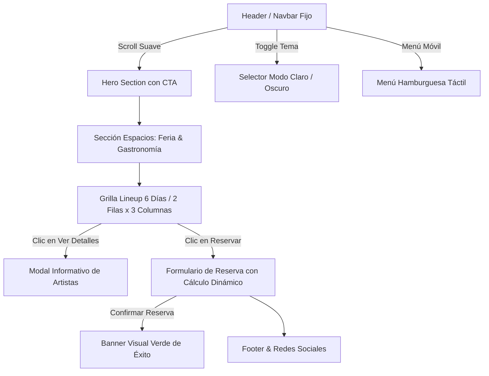

# Arquitectura del Sistema — Festival del Imperio Sur 2026

## 1. Identidad y Propósito del Proyecto
- **Proyecto**: Sitio Web Oficial del "Festival del Imperio Sur 2026".
- **Objetivo**: Single Page Application (SPA) para promocionar el festival de 6 días en Río Cuarto, destacando las temáticas diarias, grilla de artistas, espacios gastronómicos, ferias de emprendedores y permitiendo la reserva interactiva de entradas con cálculo en tiempo real.
- **Ubicación Geográfica**: Autódromo Parque Ciudad de Río Cuarto (Coordenadas: -33.178168, -64.365759), Ruta Nacional 8 Km 609, Río Cuarto, Córdoba, Argentina.

---

## 2. Stack Tecnológico Oficial
- **Estructura**: HTML5 Semántico nativo (etiquetado estricto: `<header>`, `<nav>`, `<main>`, `<section>`, `<article>`, `<figure>`, `<figcaption>`, `<button>`, `<footer>`).
- **Diseño & Estilos**: TailwindCSS v3 cargado vía CDN con configuración personalizada para modos claro y oscuro.
- **Interactividad**: JavaScript Vanilla nativo (ES6+) sin dependencias externas.
- **Tipografía**: Google Fonts (`Poppins` / `Inter`, con fallback `sans-serif`).
- **Íconos & Recursos**: Iconografía SVG inline ligera y optimizada.

---

## 3. Mapa de Módulos y Componentes de Interfaz (Wireframe Vertical)

### Detalle de Módulos:
1. **Header & Navegación Fija**:
   - Logo institucional del Festival del Imperio Sur.
   - Enlaces de anclaje: Inicio (`#inicio`), Espacios (`#espacios`), Grilla de Artistas (`#lineup`), Reserva de Entradas (`#entradas`), Ubicación (`#ubicacion`).
   - Botón de alternancia de tema (Modo Claro / Modo Oscuro).
   - Menú hamburguesa desplegable accesible para móviles.
2. **Hero Section (`#inicio`)**:
   - Título de gran impacto: *"Festival del Imperio Sur 2026"*.
   - Subtítulo de fechas y predio en la Costanera de Río Cuarto.
   - Botones Call To Action (CTA): *"Reservar Entradas"* y *"Ver Grilla de Artistas"*.
3. **Sección de Espacios y Experiencia (`#espacios`)**:
   - Tarjetas informativas de la Feria Gastronómica y la Feria de Emprendedores locales e industriales.
4. **Grilla de Días & Artistas — Lineup (`#lineup`)**:
   - 6 Tarjetas temáticas en grilla responsive (3 cols desktop, 2 cols tablet, 1 col mobile):
     - **Día 1 (Martes)**: Artistas Locales de Río Cuarto y la zona.
     - **Día 2 (Miércoles)**: Noche de Salsa y Bachata (*Dani J*, *Marc Anthony*).
     - **Día 3 (Jueves)**: Noche de Pop y Baladas (*Cristian Castro*, *Reik*, *Maná*).
     - **Día 4 (Viernes)**: Noche de Rock (*Airbag*, *Andrés Calamaro*, *Los Auténticos Decadentes*).
     - **Día 5 (Sábado)**: Noche de Cuarteto (*Q' Lokura*, *Luck Ra*, *La Konga*).
     - **Día 6 (Domingo)**: Noche de Folklore (*Destino San Javier*, *Soledad Pastorutti*, *Campedrinos*).
   - Cada tarjeta contiene: foto, temática, diferenciación de precios (*General*, *VIP*, *UltraVIP*) y botones de acción (*Ver Detalles* y *Reservar*).
5. **Modal de Detalle del Lineup**:
   - Cuadro de diálogo modal accesible (`<dialog>` o contenedor semántico con `aria-modal="true"`) con la grilla completa del día y botón de cierre.
6. **Formulario de Reserva con Cálculo Dinámico (`#entradas`)**:
   - Campos: Nombre Completo, Correo Electrónico, Teléfono, Menú desplegable de Tipo de Pase (*General*, *VIP*, *UltraVIP*), Precio Unitario, Selector de Cantidad, Costo Total calculado en tiempo real.
   - Botón de reserva con validación y banner visual verde de confirmación.
7. **Footer (`<footer>`)**:
   - Enlaces rápidos, canales de redes sociales y referencia geográfica de la Costanera (entre Puente Carretero y Puente Filloy).

---

## 4. Tecnologías Prohibidas y Límites Técnicos (Guardrails)
- ⛔ **NO Frameworks SPA Complejos**: Prohibido el uso de React, Angular, Vue, Svelte, etc.
- ⛔ **NO Backend / Servidores**: Prohibido crear servidores Node.js/Express, Python/Django, PHP, etc.
- ⛔ **NO Bases de Datos**: Prohibido el uso de SQL, MongoDB, Firebase, Supabase, etc.
- ⛔ **NO Estilos en Línea**: Prohibido utilizar `style="..."` en las etiquetas HTML.
- ⛔ **NO Abuso de `
`**: Priorizar siempre etiquetas semánticas de HTML5.
