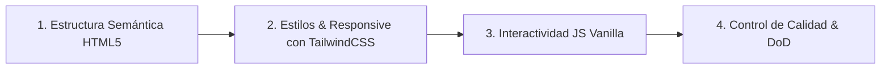

# Flujo de Trabajo SDD y Definition of Done — Festival del Imperio Sur 2026

Este documento define la metodología de desarrollo basada en **Spec-Driven Development (SDD)** ([Gentle-AI](https://github.com/Gentleman-Programming/gentle-ai)) y los criterios de aceptación indispensables (**Definition of Done**) para dar por concluida la maquetación.

---

## 🔄 Metodología de Maquetado SDD (Fases Secuenciales)

### Fase 1: Estructura HTML5 Semántica
1. Creación del archivo `index.html` con estructura base `<!DOCTYPE html>` y metadatos estándar (`viewport`, `charset="UTF-8"`, título y descripción).
2. Construcción del esqueleto semántico con jerarquía limpia:
   - `<header>` y `<nav>` con logo y anclas.
   - `<main>` con secciones identificadas (`#inicio`, `#espacios`, `#lineup`, `#entradas`).
   - `<article>` para las 6 tarjetas temáticas del Lineup.
   - `<form>` con `<fieldset>`, `<label>`, `<input>`, `<select>` y botón de acción.
   - `<footer>` con enlaces institucionales y redes.

### Fase 2: Estilizado y Diseño Responsive con TailwindCSS v3
1. Carga de TailwindCSS v3 vía CDN con configuración de colores personalizados (Bandera de Río Cuarto y Modo Oscuro).
2. Maquetación del layout en rejilla responsive:
   - **Desktop (`lg`)**: 3 columnas para las tarjetas del lineup (2 filas x 3 cards).
   - **Tablet (`md`)**: 2 columnas.
   - **Mobile (`sm` / base)**: 1 columna vertical con márgenes fluidos.
3. Incorporación de micro-interacciones: elevación y sombra en tarjetas (`hover:-translate-y-2`), zoom en fotos (`group-hover:scale-105`) y transiciones en botones.

### Fase 3: Interactividad con JavaScript Vanilla
1. **Selector de Tema (Light / Dark Mode)**: Alternar clase `dark` en `<html>` con persistencia en `localStorage`.
2. **Navegación Móvil**: Apertura y cierre interactivo del menú hamburguesa.
3. **Modal de Detalle del Lineup**: Eventos para abrir el modal con la grilla del día y botón de cierre accesible.
4. **Cálculo Reactivo de Entradas**: Detección de cambios en el tipo de entrada y cantidad para actualizar precio unitario y total.
5. **Simulación de Reserva**: Validación de campos del formulario y despliegue del banner visual verde de confirmación.

### Fase 4: Control de Calidad y Verificación
1. Inspección visual en navegador en pantallas grandes y móviles (DevTools F12).
2. Verificación de consola sin errores de script.

---

## ✅ Definition of Done (DoD)

Para considerar el maquetado terminado, se deben cumplir todos los siguientes puntos:

1. [ ] **Semántica Completa**: Uso riguroso de etiquetas semánticas (`<header>`, `<nav>`, `<main>`, `<section>`, `<article>`, `<figure>`, `<figcaption>`, `<button>`, `<footer>`), sin `
` superfluos.
2. [ ] **Diseño Responsive Verificado**: Probado en resoluciones Desktop (1920px, 1366px), Tablet (768px - 1024px) y Móvil (360px - 414px).
3. [ ] **Cero Scroll Horizontal Roto**: Sin desbordamiento de ancho en celulares (`overflow-x: hidden`).
4. [ ] **Accesibilidad e Imágenes**: Todas las imágenes cuentan con atributo `alt` descriptivo.
5. [ ] **Interactividad Funcional**:
   - Selector de modo claro/oscuro funcional.
   - Modal de detalles abre y cierra con teclado/clic.
   - Selector de pase y cantidad calcula el costo total en tiempo real.
   - Formulario despliega banner verde de éxito.
6. [ ] **Consola Limpia**: Sin errores ni advertencias en la consola de JavaScript.
